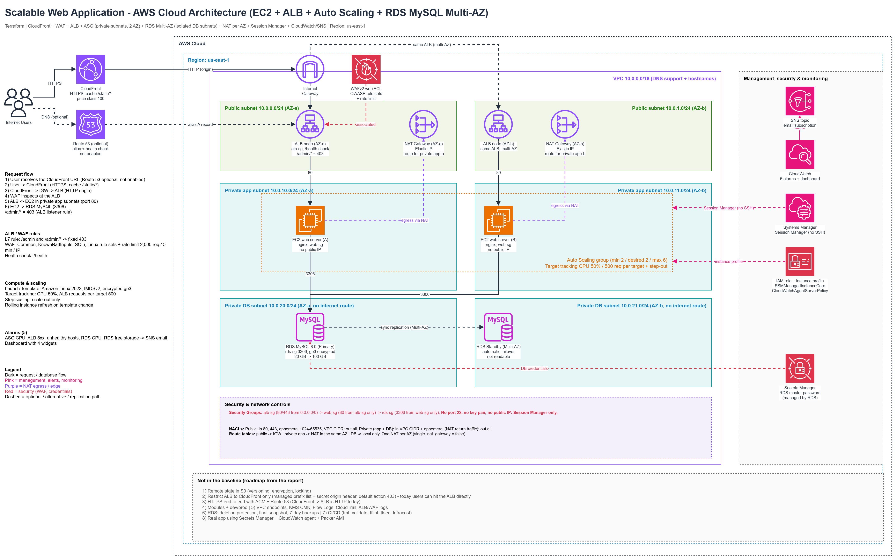

# Architecture Reference

This document is the component-by-component reference for the design summarised in the [README](../README.md).

## 1. Network layer

| Component | Configuration |
|---|---|
| VPC | `10.0.0.0/16`, DNS support and DNS hostnames enabled, region `us-east-1` |
| Public subnets | `10.0.0.0/24` (AZ-a), `10.0.1.0/24` (AZ-b) |
| Private app subnets | `10.0.10.0/24` (AZ-a), `10.0.11.0/24` (AZ-b) |
| Private DB subnets | `10.0.20.0/24` (AZ-a), `10.0.21.0/24` (AZ-b), no internet route |
| Internet Gateway | One, attached to the VPC |
| NAT Gateways | One per AZ, each with an Elastic IP, placed in the public subnet |

**Route tables**

| Route table | Default route |
|---|---|
| Public | Internet Gateway |
| Private app (AZ-a) | NAT Gateway in AZ-a |
| Private app (AZ-b) | NAT Gateway in AZ-b |
| Private DB | None; local VPC traffic only |

Using one NAT Gateway per AZ keeps egress for each AZ independent of the other.

## 2. Edge layer

**Amazon CloudFront**
- Viewers connect over HTTPS.
- A cache behaviour caches `/static/*`.
- Price class 100.
- The origin is the ALB, reached over HTTP through the Internet Gateway.

**Amazon Route 53 (optional, not enabled in the baseline)**
- Alias A record pointing to the ALB, with a health check.
- Because the alias targets the ALB, using it sends users to the ALB directly rather than through CloudFront.

## 3. Entry layer

**Application Load Balancer**
- Internet-facing, nodes in both public subnets, attached to `alb-sg`.
- Forwards to the web server target group on port 80.
- Health check path: `/health`.
- Listener rule: `/admin` and `/admin/*` return a fixed 403 response.

**AWS WAF (WAFv2) web ACL**, associated with the ALB:
- AWS managed Common rule set
- AWS managed Known Bad Inputs rule set
- AWS managed SQL injection rule set
- AWS managed Linux rule set
- Rate-based rule: 2,000 requests per 5 minutes per IP

AWS managed rule groups address common web exploit categories, including many OWASP Top 10 risks. They are not a complete OWASP Top 10 mitigation on their own.

## 4. Application layer

**Launch template**
- Amazon Linux 2023
- IMDSv2 required
- Encrypted gp3 volume
- nginx web server
- Security group `web-sg`, no public IP, no key pair
- IAM instance profile with `AmazonSSMManagedInstanceCore` and `CloudWatchAgentServerPolicy`

**Auto Scaling group**
- Minimum 2, desired 2, maximum 6
- Spans both private app subnets
- Target tracking: average CPU 50 percent; ALB requests per target 500
- Step scaling policy: scale-out only
- Rolling instance refresh when the launch template changes

## 5. Data layer

**Amazon RDS for MySQL 8.0**
- Multi-AZ: primary in the AZ-a DB subnet, synchronous standby in the AZ-b DB subnet
- Automatic failover; the standby is not readable
- Encrypted gp3 storage, 20 GB with storage autoscaling to 100 GB
- Security group `rds-sg`, port 3306 from `web-sg` only
- Master password managed through AWS Secrets Manager

## 6. Management, security, and monitoring

| Service | Role |
|---|---|
| Systems Manager Session Manager | Shell access to instances without SSH. Instances reach the Systems Manager service through the NAT Gateways. |
| IAM role and instance profile | Grants the permissions listed above |
| Secrets Manager | Holds the RDS-managed master password |
| CloudWatch | Five alarms and a four-widget dashboard |
| SNS | Topic with an email subscription for alarm notifications |

## 7. Request flow

1. User resolves the CloudFront URL (Route 53 optional, not enabled).
2. User to CloudFront over HTTPS; `/static/*` can be served from cache.
3. CloudFront to Internet Gateway to ALB over HTTP.
4. WAF inspects the request at the ALB; `/admin/*` returns 403.
5. ALB to EC2 instances in the private app subnets on port 80.
6. EC2 to RDS MySQL on port 3306.

## 8. Public versus private resources

| Public subnets | Private subnets |
|---|---|
| ALB nodes, NAT Gateways | EC2 web servers, RDS primary and standby |
| Reachable from the internet (ALB only) | No public IPs; reachable only from the ALB (web tier) or the web tier (database) |